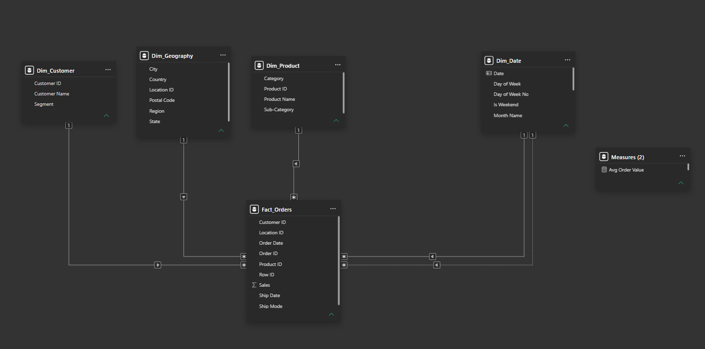
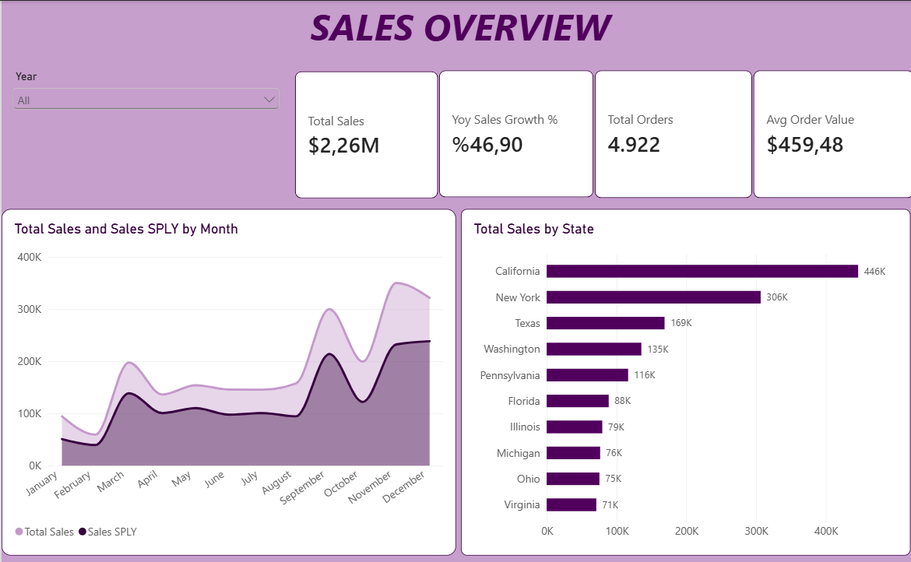
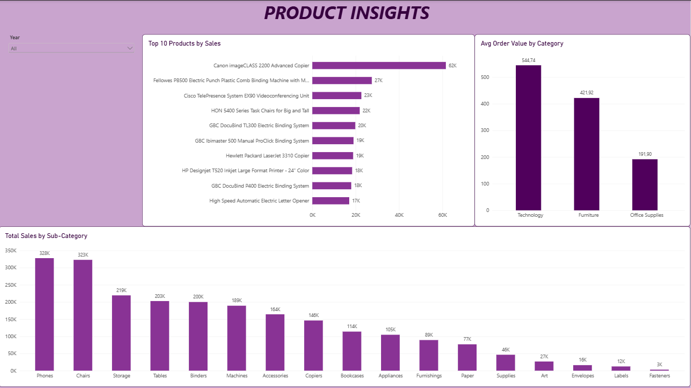
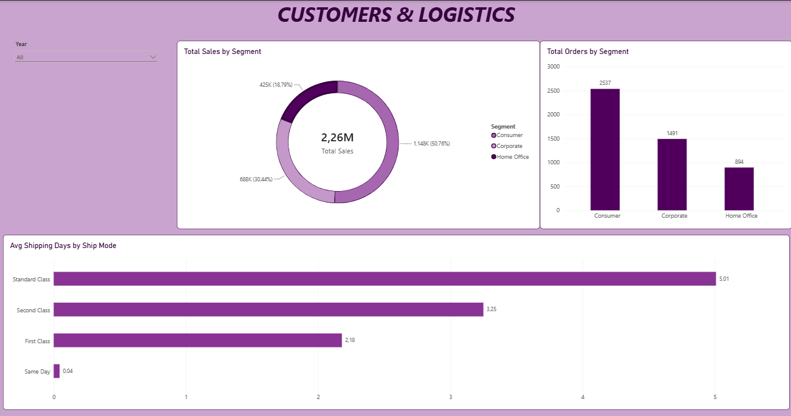

# 📊 Retail Sales & Logistics Performance Dashboard (Power BI)

An end-to-end Business Intelligence solution built with Power BI using retail sales data. This project showcases Star Schema relational data modeling, dynamic DAX measures (Time Intelligence, Iterators, Role-Playing Relationships), and interactive multi-page reporting tailored for executive decision-making.

---

## 🎯 Executive Summary & Objectives
The primary objective of this project is to analyze commercial and logistics performance across multiple business dimensions:
* **Revenue Dynamics:** Tracking sales performance against historical baselines using dynamic Time Intelligence (YoY Growth & SPLY).
* **Product Portfolio:** Analyzing revenue contributions across categories and sub-categories to isolate high-performing drivers.
* **Operational Fulfillment:** Measuring actual delivery lead times across shipping classes to assess SLA adherence.

---

## 🏗️ Data Architecture & Star Schema
The raw dataset was normalized and restructured in **Power Query** into an industry-standard **Star Schema** to ensure high data compression, optimal DAX engine performance, and unidirectional filter flow.



* **Fact Table:**
  * `Fact_Orders`: Contains granular transactional records, foreign keys, order dates, ship dates, and raw sales amounts.
* **Dimension Tables:**
  * `Dim_Customer`: Unique customer entities and demographic segmentation (`Segment`).
  * `Dim_Geography`: Regional hierarchy (`Region`, `State`, `City`, `Postal Code`) linked via a composite `Location ID`.
  * `Dim_Product`: Unique product catalog hierarchy (`Category`, `Sub-Category`, `Product Name`).
  * `Dim_Date`: Dedicated DAX-generated calendar table supporting Time Intelligence and role-playing date relationships.

---

## 📈 Dashboard Architecture & Key Insights

### 1. Sales Overview (Executive Page)

* **Core KPI Cards:** Total Revenue (**$2.26M**), YoY Sales Growth (**%46.90**), Total Orders (**4,922**), and Average Order Value (**$459.48**).
* **Seasonality Trends (Area Chart):** Compares monthly revenue against the same period last year (`SAMEPERIODLASTYEAR`), revealing significant sales concentration and demand peaks during Q4 (September, November, and December).
* **Geographic Distribution:** California (**$446K**) and New York (**$306K**) represent the top two revenue-generating markets.
* **Interactivity:** Integrated dynamic `Year` dropdown slicer allows stakeholders to isolate performance trends across individual fiscal years.

---

### 2. Product Insights (Category & Sub-Category Drilldown)

* **Top 10 Products by Sales:** Isolates leading revenue-generating items, led by the *Canon imageCLASS 2200 Advanced Copier* (**$62K**).
* **Sub-Category Hierarchy:** Highlights volume and revenue drivers; *Phones* (**$328K**) and *Chairs* (**$323K**) dominate total sales, while high-frequency items in Office Supplies maintain transaction velocity.
* **Average Order Value (AOV) by Category:** *Technology* yields the highest basket value (**$544.74**), followed closely by *Furniture* (**$421.92**) and *Office Supplies* (**$191.90**).

---

### 3. Customers & Logistics (Fulfillment & Segmentation)

* **Customer Segmentation:** *Consumer* accounts for **50.76% ($1.15M)** of total sales across **2,537** orders, while *Corporate* represents **30.44% ($688K)** and *Home Office* represents **18.79% ($425K)**.
* **Logistics & Delivery SLA Analysis (`Avg Shipping Days`):**
  * `Same Day`: **0.04 Days** (Immediate operational dispatch).
  * `First Class`: **2.18 Days**.
  * `Second Class`: **3.25 Days**.
  * `Standard Class`: **5.01 Days**.
  * Confirms consistent operational fulfillment aligned with shipping tier commitments.

---

## 📐 Key DAX Measures

### 1. Sales Volume & Basket Metrics
```dax
Total Sales = SUM(Fact_Orders[Sales])
Total Orders = DISTINCTCOUNT(Fact_Orders[Order ID])
Avg Order Value = 
DIVIDE([Total Sales], [Total Orders], 0)
Sales SPLY = 
CALCULATE(
    [Total Sales],
    SAMEPERIODLASTYEAR(Dim_Date[Date])
)
YoY Sales Growth % = 
VAR SalesLY = [Sales SPLY]
RETURN
    DIVIDE([Total Sales] - SalesLY, SalesLY, 0)
Avg Shipping Days = 
VAR TotalShippingTime = 
    SUMX(
        Fact_Orders, 
        DATEDIFF(Fact_Orders[Order Date], Fact_Orders[Ship Date], DAY)
    )
VAR TotalRows = COUNTROWS(Fact_Orders)
RETURN
    DIVIDE(TotalShippingTime, TotalRows, 0)
Shipped Sales = 
CALCULATE(
    [Total Sales],
    USERELATIONSHIP(Dim_Date[Date], Fact_Orders[Ship Date])
)
